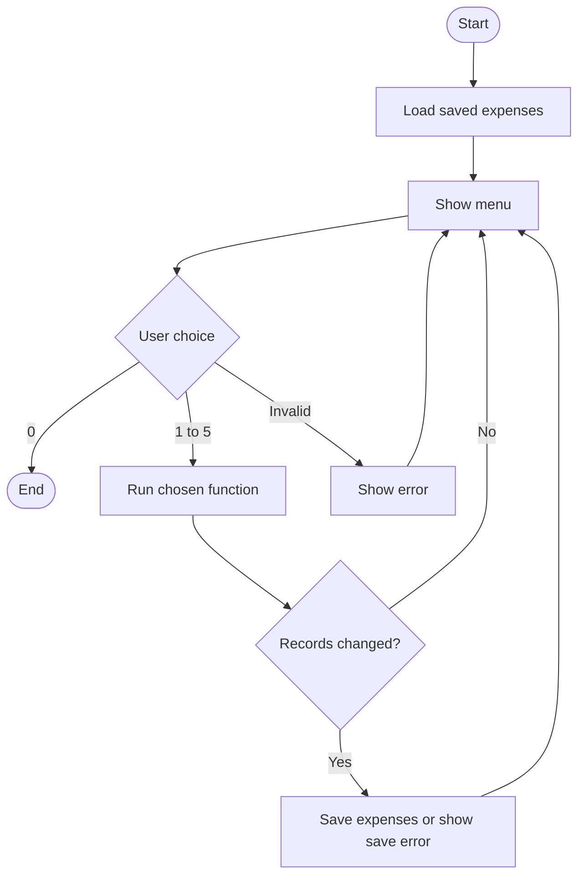

# Personal Expense Tracker


Our CS0053 TN33 group project is a C++ program for recording daily expenses in PHP.


**Starter only:** The menu works. Functions marked `TODO` still need to be implemented.


## Features


1. **Add** - Record an expense with a unique ID.
2. **View** - Show all expenses.
3. **Search** - Find expenses by category.
4. **Update** - Edit an expense using its ID.
5. **Delete (later)** - Remove an expense using its ID.


Start with the first four. All five must work before submission.
Save records in `expenses.txt` and load them when the program starts.


## Who Does What?


Replace Member 1-4 with your names. Find your member number in `main.cpp`.


| Member | Functions to complete |
| --- | --- |
| Sam | `addExpense()`; maintain `showMenu()` and `main()` |
| Silva | `viewExpenses()` and `displayExpense()` |
| Jorge| `searchExpenses()`, `loadExpenses()`, `saveExpenses()`, and `readExpenseDetails()` |
| 4 | `updateExpense()` and later `deleteExpense()`; coordinate testing |


Each expense stores an **ID, date, category, amount, and description**.
All features use the same `expenses` list.


- Add, update, and delete return `true` only when they change the list. Then `main()` saves it.
- `displayExpense()` prints one record. View and search can reuse it.
- `readExpenseDetails()` asks for valid details. Add and update can reuse it.
- Check invalid input, empty lists, missing IDs, and file errors.


## Program Flow


This shows the intended flow after the TODO functions are completed.





## Run the Starter


Use VS Code and G++ with C++17 support. Put `main.cpp` inside `src/`.
From the project folder, compile:


```bash
g++ -std=c++17 -Wall -Wextra src/main.cpp -o expense_tracker
```


Run on macOS/Linux: `./expense_tracker`


On Windows PowerShell, compile with `-o expense_tracker.exe`, then run `.\expense_tracker.exe`.


Example from the current starter:


```text
Choose an option: 1
Member 1: Add expense is not implemented yet.
```


## Team Workflow


1. Pull the latest `main`, then create your own feature branch.
2. Edit your assigned functions. Agree before changing shared code or function names.
3. Compile and check your changes.
4. Push your branch and open a pull request. A teammate reviews it before merging.
5. Pull the updated `main` after merging.


Each member needs at least **3 meaningful commits** and **1 reviewed pull request**.
Keep test results and required tool/AI evidence for the final report.
Do not commit executables or personal expense data.


